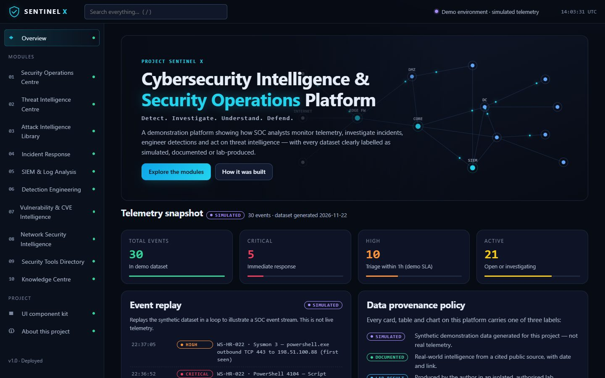
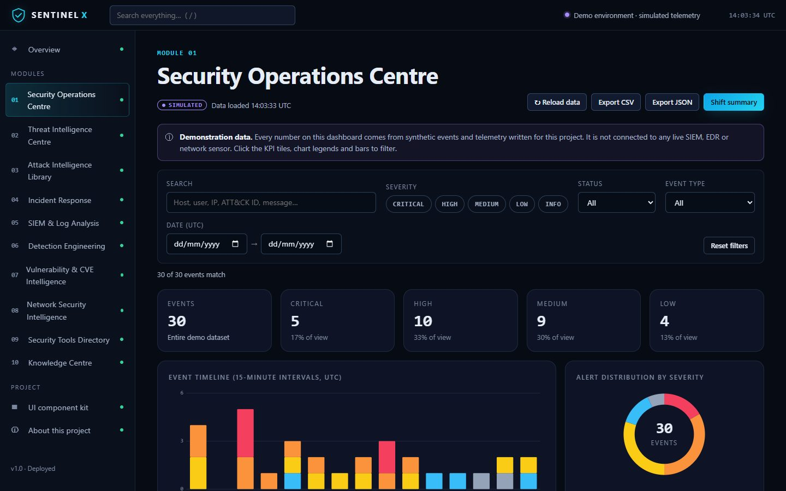
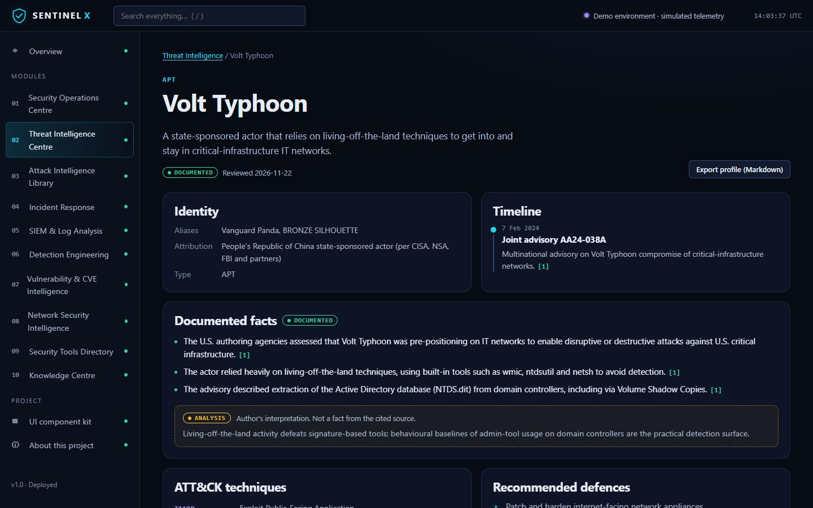
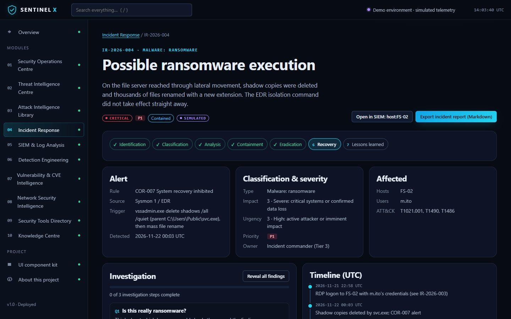
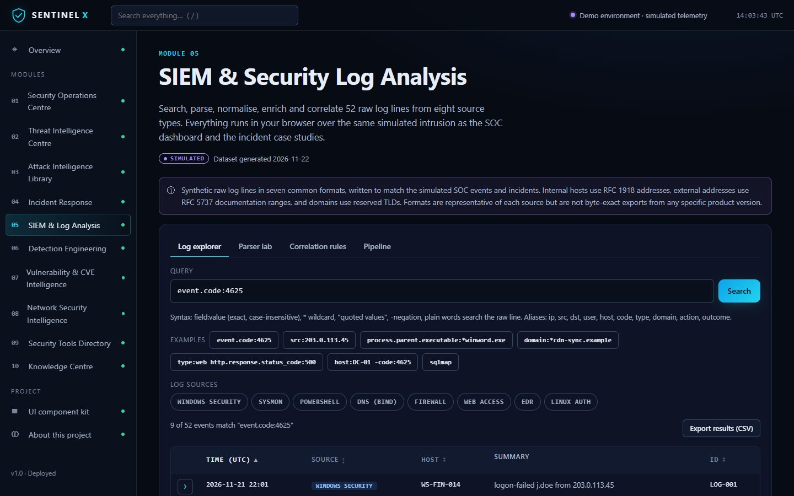
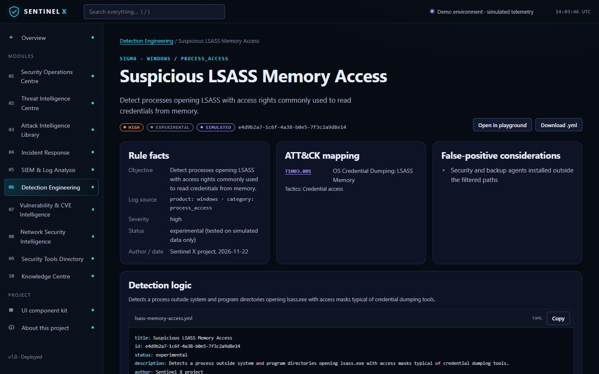
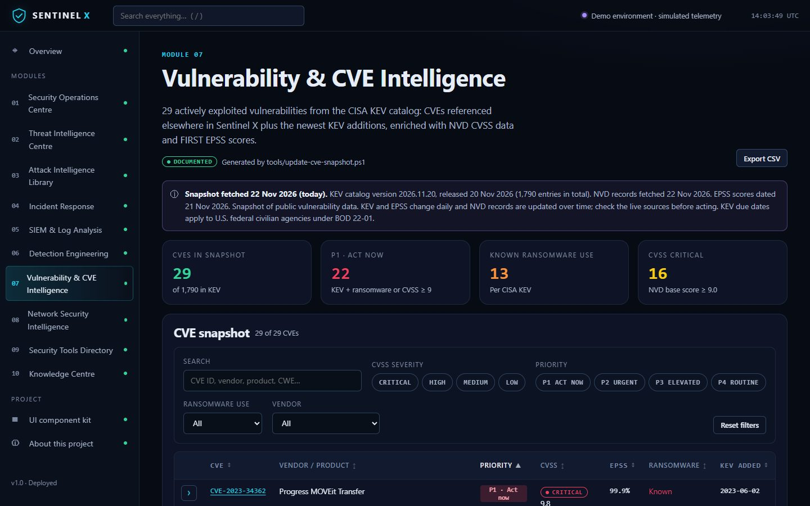
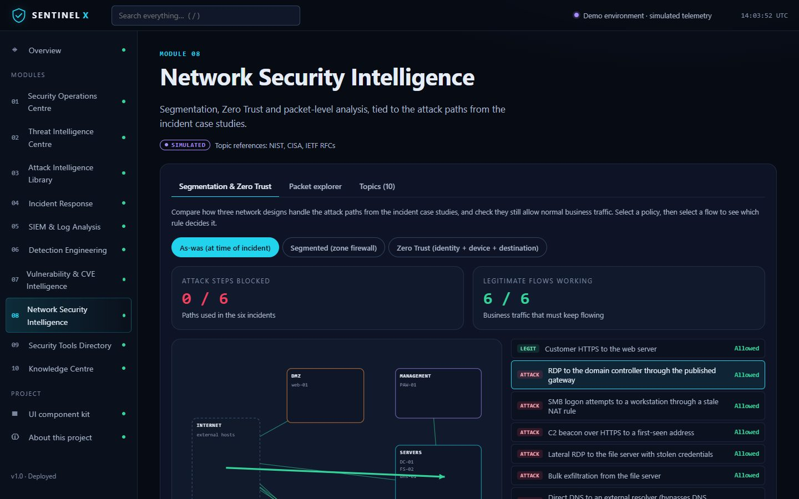
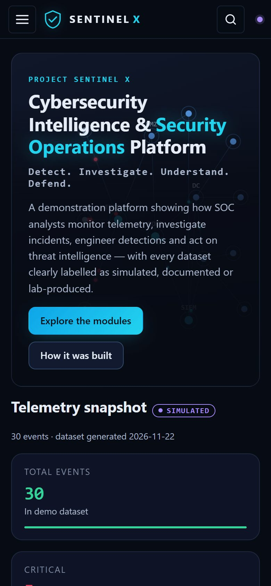

# PROJECT SENTINEL X

**Cybersecurity Intelligence & Security Operations Platform** — *Detect. Investigate. Understand. Defend.*

[](https://github.com/joachimcybersec/project-sentinel-x/actions/workflows/ci.yml)

A demonstration platform showing how security teams monitor telemetry, investigate incidents, engineer
detections and act on threat intelligence. Every dataset is labelled **Simulated**, **Documented** (cited
public source) or **Lab result**. It does not ingest live telemetry from any organisation.

**Live demo:** <https://joachimcybersec-project.netlify.app> ·
**Case study:** [docs/case-study.md](docs/case-study.md) ·
**Demo walkthrough:** [docs/demo-guide.md](docs/demo-guide.md)



> **Status: complete (v1.0.0, all 12 phases).** Ten live modules with site-wide search, a security review and
> QA pass ([findings](docs/security-review.md)), deployment on Netlify, and CI (Chromium, Firefox, WebKit)
> passing on GitHub. The IOC-lookup proxy is deployed but has **no provider API keys set**, so live lookups
> report "not configured" until keys are added.

## Project objectives

1. Show the **analyst workflow end to end**: one simulated intrusion can be followed from a SOC alert, to raw
   evidence in the SIEM, to the detection rule that caught it, to the incident write-up and the network
   control that would have stopped it.
2. Demonstrate **working security engineering**, not screenshots of other tools: a Sigma evaluator, log
   parsers and normalisation, a query language, correlation rules, a packet builder with real checksums, a
   CVSS calculator and a policy simulator, all implemented and tested in this repository.
3. Treat **honesty as a feature**: every number and claim is labelled as simulated, documented (with a dated
   source) or lab result, and nothing implies a live integration that does not exist.
4. Be built the way production software should be: strict CSP with Trusted Types, safe DOM rendering, a
   serverless proxy that keeps API keys off the client, automated tests in three browser engines, and
   written records of what was and was not verified.

## Features (implemented)

### Modules

- **Module 01 — SOC dashboard** (`#/soc`): severity KPI tiles, 15-minute event timeline, severity donut,
  incident-status breakdown, events by type, detection activity by ATT&CK technique, suspicious-login and
  endpoint panels, network traffic and DNS charts, system health, event queue with an investigation drawer.
  KPI tiles, legends and bars act as filters. Reload control, CSV/JSON export and a shift-summary report.
  All charts are dependency-free SVG with data-table fallbacks
- **Module 02 — Threat Intelligence Centre** (`#/threat-intel`): 10 profiles (ransomware, APT, botnet,
  phishing and exploitation campaigns). Each fact links to a numbered public source with its date, and
  analysis is labelled separately. Includes a simulated defanged IOC watchlist with CSV export, a source-report
  index, Markdown export per profile and a **Live lookup** tab backed by the serverless proxy
- **Module 03 — Attack Intelligence Library** (`#/attacks`): 14 attack dossiers × 10 sections (overview,
  methodology, cited real-world incident, ATT&CK mapping, indicators, log sources, detections, controls,
  response, references), cross-linked with the threat profiles, with Markdown export
- **Module 04 — Incident Response** (`#/incidents`): six simulated case studies (failed authentication,
  suspicious admin login, PowerShell execution, ransomware, DNS-based C2, data exfiltration) with a priority
  matrix, lifecycle tracker, step-by-step investigation linked to raw evidence logs, timeline, root cause,
  chain of custody, containment/eradication/recovery, lessons learned and Markdown report export
- **Module 05 — SIEM & Log Analysis** (`#/siem`): 52 raw logs in 7 formats (Windows, Sysmon, PowerShell,
  Linux auth, firewall, BIND DNS, web, EDR). Includes in-browser parsers and ECS-style normalisation, a query
  language with shareable deep links (`#/siem?q=…`), a parser lab for pasted lines, asset and IOC enrichment,
  8 tunable correlation rules, and a pipeline view. Open-source SIEM tools are mapped to the stages and clearly
  marked as not integrated
- **Module 06 — Detection Engineering** (`#/detections`): 16 Sigma rules across Windows, Sysmon, PowerShell,
  Linux, DNS, web and firewall sources. Each rule is evaluated live by an in-browser Sigma evaluator (supported
  modifiers and taxonomy names checked against the Sigma specification) and must match exactly its expected
  sample logs in the test suite. Includes coverage by ATT&CK technique and by incident, a rule playground with
  validation, and `.yml` download. Rules are `experimental`: tested on simulated data; `sigma check` (pySigma)
  passes in CI
- **Module 07 — Vulnerability & CVE Intelligence** (`#/vulnerabilities`): a snapshot of actively exploited
  CVEs generated by `tools/update-cve-snapshot.ps1` from **CISA KEV**, **NIST NVD (CVE API 2.0)** and
  **FIRST EPSS**, with freshness shown for each source. Includes a transparent prioritisation model, filters,
  CSV export, and CVE pages with CVSS breakdown, KEV required action, CWE and links to related Sentinel X content
- **Module 08 — Network Security Intelligence** (`#/network`): a simulator comparing an as-was, a segmented
  and a Zero Trust policy against the incident attack paths. Includes a packet explorer that builds real
  Ethernet/IPv4/TCP/UDP/DNS bytes with verified checksums, and ten topic briefs referencing NIST, CISA and RFCs
- **Module 09 — Security Tools Directory** (`#/tools`): 33 tools across 10 categories (SIEM, EDR/XDR,
  IDS/IPS, vulnerability assessment, network analysis, threat intelligence, forensics, incident response,
  penetration testing, cloud). Each has a broad licence type, use cases, official documentation and links to
  practise the concept in Sentinel X. Includes five multi-tool example workflows
- **Module 10 — Knowledge Centre** (`#/knowledge`): 20 original articles across 10 subject areas, each citing
  authoritative sources. Includes five learning pathways that mix reading with hands-on tasks in the platform
  (progress saved in the browser only)

### Platform

- **Site-wide search**: the top-bar search box (press `/`) searches modules, articles, tools, threat profiles,
  attack dossiers, Sigma rules, CVEs, incidents and network topics
- **Serverless IOC lookup** (`netlify/functions/ioc.mjs` → `GET /api/ioc`): AbuseIPDB, VirusTotal and
  AlienVault OTX behind a server-side proxy (keys in environment variables, input validation, no private or
  documentation indicators sent upstream, allow-listed hosts, normalised minimal output, CDN caching, privacy-
  conscious logging). The Threat Intelligence "Live lookup" tab uses it and explains when it is not configured
- **Automation** (`.github/workflows/`): CI runs a pre-deploy check, the test suite and route smoke tests in
  Chromium, Firefox and WebKit, plus `sigma check`; a daily workflow refreshes the CVE snapshot; a weekly
  workflow re-checks every source link and claim
- **Source checks**: `tools/check-links.ps1` (every URL resolves) and `tools/check-claims.ps1`
  (each source still contains the phrases our facts rely on)
- **UI component kit** (`#/components`): filter bar (search, severity chips, selects, UTC date range, reset),
  sortable paginated table, `<dialog>`-based detail drawer, ARIA tabs, toasts, Sigma/YAML code viewer,
  expandable panels, CSV/JSON export with CSV-injection protection, all keyboard-operable
- Animated network-topology hero (Canvas 2D) that pauses off-screen and respects reduced motion
- KPI tiles and pausable event replay computed from a validated, simulated dataset
- Hash router with deep links, 404 handling, focus management, a per-route `document.title`, and serialised
  navigations (a slow view can never render over a newer one)
- Responsive shell: sidebar on desktop, accessible off-canvas drawer on mobile (Escape, focus return)
- Safe-DOM rendering layer, strict CSP with **Trusted Types** enforcement, security headers
- Accessibility audit (`tests/a11y-audit.js`) run on every route and tab panel; module code loads on demand
- 127 browser-run unit, data, component and backend tests

## Screenshots

Captured from the v1.0.0 build (Chrome, 1440×900, reduced motion), the same code that is deployed. All data shown is simulated or cited.

| | |
|---|---|
|  |  |
| **01 SOC dashboard**: filterable KPIs and charts over the simulated intrusion | **02 Threat profile**: every fact cited and dated; analysis labelled separately |
|  |  |
| **04 Incident case**: lifecycle tracker, guided investigation, link to the raw evidence | **05 SIEM**: query language over parsed, normalised raw logs |
|  |  |
| **06 Detection rule**: Sigma evaluated live against the same logs | **07 Vulnerabilities**: KEV + NVD + EPSS snapshot with a transparent priority model |
|  |  |
| **08 Network**: which policy would have blocked each attack step | **Mobile**: responsive layout at 390 px |

## Architecture

Static-first SPA (Tier A) with an optional serverless intel proxy (Tier B, Phase 9).
See [docs/architecture.md](docs/architecture.md) for the system diagram, sitemap, stack, roadmap and data sources.

```
Browser ── app.js → router.js → views/* → utils/dom.js
              ├── data-service.js ──► /data/*.json (CDN; CVE snapshot refreshed daily by GitHub Actions)
              └── ioc-lookup.js ────► /api/ioc Netlify Function ──► AbuseIPDB · VirusTotal · OTX
```

## Technologies used

| Area | Choice | Why |
|---|---|---|
| Front end | HTML, CSS, vanilla ES modules; no framework, no build step | Every line is reviewable; nothing to patch in a dependency tree; works on any static host |
| Charts and visuals | Hand-written SVG charts with data-table fallbacks; Canvas 2D topology | No chart library; each chart stays accessible |
| Security | CSP (`script-src 'self'`, Trusted Types), safe-DOM helper with an attribute allow-list, `safeUrl`, HSTS, COOP/CORP, frame denial | Injection sinks are refused by the browser itself, not just avoided by convention |
| Back end | Netlify Functions v2 (Node), one endpoint: `/api/ioc` | Keeps provider API keys server-side; no always-on server to maintain |
| Data | Static JSON validated by tests; CVE snapshot from CISA KEV, NVD and FIRST EPSS | Reproducible; every external fact carries its source and date |
| Detection content | Sigma rules (YAML), an in-browser Sigma evaluator, pySigma `sigma check` in CI | Rules are executable and verified against the logs they should match |
| Testing | In-browser test runner (127 tests), Playwright 1.49 driver, DOM-based accessibility audit | Same tests run locally and in CI in Chromium, Firefox and WebKit |
| Automation | GitHub Actions pinned to commit SHAs (CI, daily CVE refresh, weekly source checks); PowerShell tooling | Supply-chain hygiene; content is re-verified on a schedule |
| Hosting | Netlify (static + functions), deployed from `main` | Security headers and redirects defined in `netlify.toml`, in version control |

## Verified results

What has been run, not just written. Full records in [docs/testing.md](docs/testing.md).

- **127 / 127** unit, data, component and backend tests pass in **Chromium, Firefox and WebKit** (GitHub Actions)
- **21 routes, every tab panel**: no console errors and no findings from the accessibility audit, in all three engines
- **Live site**: security headers present, internal folders return 404, `/api/ioc` behaves as documented
  (private and documentation indicators never sent upstream, 400 on bad input, 405 on POST)
- **Security review** ([security-review.md](docs/security-review.md)): a link-sanitiser bypass found and
  fixed with regression tests; Trusted Types enforced with zero violations from the app
- **Bugs found by the test pipeline and fixed**: a navigation race that rendered a view twice (found by CI on
  WebKit), intermittent sub-24 px touch targets, and test-harness issues under the strict CSP
- **W3C Nu validator**: `index.html` validates with 0 errors
- **16 / 16** Sigma rules pass `sigma check`; each matches exactly its expected sample logs

## Run locally

ES modules need HTTP (`file://` will not work). No install is needed on Windows:

```powershell
powershell -ExecutionPolicy Bypass -File .\serve.ps1
```

Then open http://localhost:8080/ (app) and http://localhost:8080/tests/ (tests).
With Node installed, `npx serve .` also works. Before deploying, run
`powershell -ExecutionPolicy Bypass -File .\tools\predeploy-check.ps1`.

**Configuration:** the site needs none. To enable live IOC lookups, set `ABUSEIPDB_API_KEY`,
`VIRUSTOTAL_API_KEY` and/or `OTX_API_KEY` as Netlify environment variables (never in the code). See
[docs/deployment.md](docs/deployment.md).

## Project structure

```
index.html  netlify.toml  serve.ps1  serve.json  package.json  SECURITY.md  CHANGELOG.md  LICENSE
css/        main.css · components.css · dashboard.css · responsive.css
js/         app.js · router.js · navigation.js · data-service.js
            utils/{dom,attack}.js · effects/topology.js
            views/{home,module-status,about,components,soc,threat-intel,attacks,incidents,siem,detections,
                   vulnerabilities,network,tools,knowledge}.js
            detection/{yaml,sigma}.js · network/{packets,policy,cvss}.js · search/search.js
            components/{data-table,filter-bar,tabs,drawer,event-drawer,log-view,toast,export,code-block,charts,intel-ui}.js
            siem/{parsers,query,correlation}.js
            shared/indicators.js · components/ioc-lookup.js
data/       modules.json · sample-events.json · soc-telemetry.json
            threat-intelligence.json · attack-library.json
            sample-logs.json · incidents.json · siem-tools.json · detection-rules.json
            cve-snapshot.json (generated) · network.json · tools.json · knowledge.json
netlify/    functions/ioc.mjs · lib/ioc-core.mjs
rules/      16 exported Sigma .yml files
tools/      check-links.ps1 · check-claims.ps1 · update-cve-snapshot.ps1 · export-sigma.ps1 · predeploy-check.ps1
.github/    workflows/ci.yml · refresh-cve-snapshot.yml · source-checks.yml
docs/       architecture.md · deployment.md · security.md · security-review.md · testing.md
            case-study.md · demo-guide.md · screenshots/
tests/      index.html · test-runner.js · *.test.js · a11y-audit.js · run-in-browser.mjs
```

## Testing · Security · Deployment

- [docs/testing.md](docs/testing.md) — what was run and what passed, plus checks still to do
- [docs/security.md](docs/security.md) — the controls in place and the threat model
- [docs/deployment.md](docs/deployment.md) — step-by-step deployment (GitHub + Netlify, or the Netlify CLI), live checks and rollback
- [SECURITY.md](SECURITY.md) — how to report a vulnerability · [CHANGELOG.md](CHANGELOG.md) — what changed in each phase

## Limitations

- All telemetry is synthetic. No SIEM/EDR integration exists; none is claimed.
- Tool descriptions and licence types are summaries; vendors change features and terms, so check the official
  documentation. Listing a tool is not an endorsement.
- Search uses simple substring matching over an in-memory index (no stemming or typo tolerance).
- The IOC lookup function is deployed but has no provider API keys set, so it has not yet returned real
  provider data. Its provider handling was tested against simulated responses that follow each API's
  documented fields.
- The CVE snapshot is a point-in-time copy (generated 2026-11-22). The daily workflow refreshes it; to refresh
  by hand: `powershell -ExecutionPolicy Bypass -File .\tools\update-cve-snapshot.ps1`. The page warns when the
  data is more than 7 days old. The prioritisation tiers are a teaching model, not an industry standard.
- The segmentation simulator is a simplified model of policy decisions, not a firewall emulator.
- The Sigma evaluator implements a documented subset of the specification (no aggregations, correlation
  rules or base64/windash modifiers).
- The SIEM module demonstrates SIEM concepts in the browser. It is not connected to Wazuh, Elastic or any
  other SIEM, and its log formats are representative rather than byte-exact vendor exports.
- Incident case studies are simulated; the organisation, people and findings are fictitious.
- Threat profiles reflect the cited sources as of their review date (2026-11-22); they are not a live feed.
  Re-run the link and claim checks before presenting, because advisories get updated.
- The SOC dashboard's "Reload data" re-reads the static JSON; it is not a live feed.
- Not yet done: a screen-reader pass, a reduced-motion check with the OS setting, and Lighthouse scores on the
  deployed site (see docs/testing.md). On Netlify's free plan, an injected "Powered by Netlify" script is
  blocked by the CSP and logs one console error ([details](docs/deployment.md)).

## Future improvements

- Add provider API keys and verify live lookups against each provider's web UI
- Lab results: run the Sigma rules in an isolated, authorised lab (e.g. Sysmon on a test VM) and publish
  the captured events as **Lab result** data, replacing simulated samples where possible
- Export rules to a real SIEM back end with pySigma (Splunk, Elastic) and show the converted queries
- Screen-reader pass (NVDA / VoiceOver) and Lighthouse budgets enforced in CI
- IPv6 and URL indicators in the lookup proxy; fuzzy matching in site-wide search
- Optional ATT&CK Navigator layer export from the detection coverage view

## References

MITRE ATT&CK — https://attack.mitre.org/ · CISA KEV — https://www.cisa.gov/known-exploited-vulnerabilities-catalog ·
NIST NVD — https://nvd.nist.gov/ · FIRST EPSS — https://www.first.org/epss/ · NIST SP 800-61 (Incident Handling) ·
OWASP — https://owasp.org/ · RFC 5737 (documentation IP ranges) · Sigma — https://github.com/SigmaHQ/sigma

## License

MIT. See [LICENSE](LICENSE).
